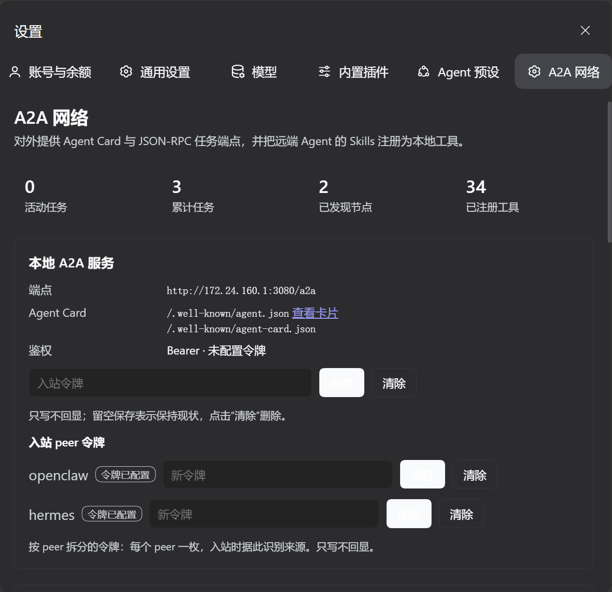
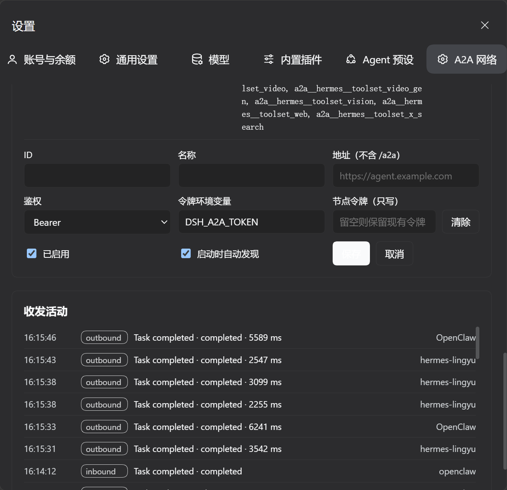

# A2A

把 DeepSeek Harness 接入 [Agent2Agent (A2A)](https://a2a-protocol.org/) 网络：**对外**它是一个符合规范的 A2A Server（入站按 peer 分配独立令牌），**对内**它把远端 Agent 的 Skills 变成 DSH 可以直接调用的工具。

- 包名：`@jasper_alaric/dsh-a2a`（1.1.0）
- Bundle 行 id：`dsh-a2a`
- 协议：A2A **0.3.0** / **0.2.x**，并兼容 **1.0（protoJSON）** 的 `SendMessage` 等方法名与 `ROLE_*` 角色枚举
- 入站鉴权：`server.auth.peers` 按 peer 拆分令牌；旧单令牌仅作显式回退
- 运行时依赖：**0 个第三方库**（只用 Node 内置模块与全局 `fetch`）
- 双向工具调用已用 **OpenClaw** 与 **Hermes** 实测通过

## 界面





---

## 1. 当前进度

| 步骤 | 内容 | 状态 |
| --- | --- | --- |
| 1 | 目录结构、依赖清单、构建骨架、共享协议类型 | ✅ 已完成 |
| 2 | 插件注册入口 `index.ts`、Config、`A2AService`、Agent Card、Bearer 鉴权、路由骨架 | ✅ 已完成 |
| 3 | 入站 `tasks/send` / `sendSubscribe`、任务状态机、DSH Agent 执行器、SSE | ✅ 已完成 |
| 4 | 出站 Agent Card 发现、远程 Skills → Tools、设置面板 | ✅ 已完成 |
| 5 | curl / Postman、双向 E2E、安全/测试文档、打包与安装验证 | ✅ 已完成（真实模型与像素渲染待人工） |

> 双向链路都已接通：入站任务、SSE、多轮 `input-required`；出站发现、节点令牌、Skill → Tool 动态注册、同源管理 API 与 `settings.section` 面板。目录树中带 `✅` 的文件已存在，带 `⏳` 的是第 5 步的交付物。

---

## 2. 为什么这样设计

### 2.1 不引入 `@a2a-js/sdk`

A2A 的线上协议本体很小：一套 JSON-RPC 2.0 方法 + 一组 Task/Message/Part 类型 + SSE 流。引入官方 SDK 会同时带入它自己的 HTTP 框架、校验层和版本节奏，而 DSH 已经提供了：

- `ctx.webServer.register()`：完整的 `node:http` 路由与 SSE 响应生命周期；
- `ctx.tools.register()` + `defineTool()`：带 JSON Schema 校验、取消信号、展示信息的工具注册；
- 全局 `fetch`：出站 JSON-RPC 与 Agent Card 发现。

因此本插件**自己拥有协议类型**（`src/shared/protocol.ts`），只用原生 `fetch` 发请求。好处是：

1. 安装包不需要 `npm install` 任何运行时依赖；
2. 协议行为可测试、可审计，不被 SDK 的内部实现锁死；
3. 同一份类型被 Host 与 Client 共用，避免两边漂移。

如果后续需要接入 SDK 的高级特性（签名卡片、gRPC transport），可以在 `host/outbound/rpc-client.ts` 后面加适配器，而不改状态机与工具层。

### 2.2 Host 与 Client 的职责边界

| 层 | 位置 | 职责 |
| --- | --- | --- |
| Host | `src/host/**` | 路由、鉴权、任务状态机、DSH Agent 调用、远端 RPC、工具注册、管理 API |
| Client | `src/client/**` | 设置面板：节点增删改、Agent Card 暴露状态、任务/日志实时流 |
| Shared | `src/shared/**` | A2A 类型、常量、纯函数；不碰 `node:*`，可被浏览器打包 |

Client 永远不直接调用远端 A2A 节点，也不接触 Bearer Token；它只调用同源的 `/a2a/admin/*`，由 Host 完成鉴权与出站请求。这样令牌不会进入浏览器内存，也避免 CORS 与 SSRF 面扩大。

### 2.3 入站任务跑在哪个 Agent 里

外部请求没有 DSH 的“当前会话”上下文，因此插件为每个 A2A `contextId` **确定性地**派生一个独立 Session（`a2a-<sha256(contextId) 前 32 位>`），通过 `ctx.agents.create/resume` 创建或恢复 Agent，再 `followup()` 投递消息。

- 不会劫持用户正在使用的会话；
- 任务仍写入正常的 Session 日志，可在 DSH 的会话列表/导出中审计；
- 同一个 `contextId` 的多次请求共享同一个 Session，从而实现 A2A 的多轮上下文；
- 模型路由优先用配置里的 `server.model`，否则回退到 `ctx.get('agentDefaultModel')?.currentSelection()`；
- A2A Agent 的工具集与普通 Agent 相同，但审批类交互会被 `interaction-bridge` 接管或拒绝，避免无人应答时永久挂起。

---

## 3. 总体架构

```
                        ┌──────────────────────────── DSH Host ────────────────────────────┐
                        │                                                                  │
  A2A peer ──GET───────▶│  /.well-known/agent.json + agent-card.json ──▶ agent-card.ts     │
  (外部调用方)           │                                                                  │
           ──POST──────▶│  /a2a ──▶ jsonrpc.ts ──▶ methods.ts ──▶ TaskManager               │
                        │                              │              │                    │
                        │                              │              ├─▶ task-machine.ts  │
                        │                              │              ├─▶ agent-executor ──┼──▶ ctx.agents.create/resume
                        │                              │              │        │           │         │
                        │                              │              │        └───────────┼──▶ session/event (assistant/*, turn/end)
                        │                              │              └─▶ interaction bridge│         │
                        │                              │                       (input-required)
                        │                              └─▶ sse.ts (status-update / artifact-update)
                        │                                                                  │
  DSH model ──tool call─▶ tool-registrar ──▶ rpc-client ──fetch/SSE──▶ remote /a2a           │
                        │        ▲                                                         │
                        │        └── node-registry ◀── admin API ◀── settings panel (Client)│
                        └──────────────────────────────────────────────────────────────────┘
```

### 入站（Server）

1. 外部 Agent 拉取 Agent Card，拿到端点、能力、Skills 与鉴权方案。按你的要求主路径是 `/.well-known/agent.json`；A2A 0.3 的标准路径 `/.well-known/agent-card.json` 作为同内容别名一并提供（0.3 规范已把 discover 路径从 `agent.json` 迁到 `agent-card.json`）。
2. 外部 Agent 向 `/a2a` POST 一个 JSON-RPC 2.0 请求（`message/send`、`tasks/send`、`message/stream`、`tasks/sendSubscribe`……）。
3. `JsonRpcDispatcher` 校验信封与参数，交给 `TaskManager`。
4. `TaskManager` 创建/恢复 Task，按状态机推进：`submitted → working → input-required → completed | canceled | failed`。
5. `AgentExecutor` 用 **contextId 确定性派生**的 DSH Session 创建或恢复一个 Agent，把 A2A Message 转成 `UserMessage` 后 `followup()`。
6. 监听 `session/event`：`assistant/message` 转成 A2A Artifact；`turn/end` 决定 `completed` / `failed`；`user-questions/request` 挂起为 `input-required`。
7. 非流式请求在终态返回完整 `Task`；流式请求通过 SSE 持续发送 `status-update` / `artifact-update`，断线后可用 `tasks/resubscribe` 续订。

### 出站（Client）

1. `NodeRegistry` 保存用户配置的远端节点（名称、URL、启用状态、鉴权引用）。
2. `AgentCardDiscovery` 先拉取 `<base>/.well-known/agent-card.json`，404 时回退 `<base>/.well-known/agent.json`，校验并缓存卡片。
3. `RemoteSkillToolRegistrar` 为每个 Skill 注册一个本地工具：`a2a__<node>__<skill>`，并生成模型可读的 description / JSON Schema。
4. 模型调用工具 → `A2AClient` 发送 `message/send`（0.3）或 `tasks/send`（0.2），携带 `contextId` 延续多轮；结果转成工具的规范化输出。
5. 面板通过管理 API 增删改节点、刷新卡片、查看任务与收发日志。

---

## 4. 目录结构

```text
plugins/dsh-a2a/
├── package.json                          ✅ bundle 清单、exports、dsh.bundle / dsh.client、依赖
├── package-lock.json                     ✅ 可复现的开发依赖锁
├── tsconfig.json                         ✅ 严格模式、Bundler、JSX、声明输出
├── tsconfig.test.json                    ✅ 源码 + 测试的完整类型检查
├── vitest.config.ts                      ✅ 测试入口与超时
├── .gitignore                            ✅ 忽略 node_modules / lib / coverage
├── LICENSE                               ✅ MIT
├── cordis.patch.yml                      ✅ 插入 dsh-a2a 行并给出默认配置
├── icon.svg                              ✅ 原创图标（双向节点）
├── locale/
│   ├── en.json                           ✅ Plugin Manager 展示用英文标题/描述
│   └── zh.json                           ✅ 中文标题/描述
├── README.md                             ✅ 本文件
├── CHANGELOG.md                          ✅ 1.0.0 变更记录
├── docs/
│   ├── protocol.md                       ✅ 方法映射、状态机、错误码、SSE 示例
│   ├── security.md                       ✅ 威胁模型、令牌轮换、SSRF 策略
│   └── testing.md                        ✅ 测试矩阵与验收入口
├── scripts/
│   └── build.mjs                         ✅ Host ESM + Client loader 包装 + 类型声明
├── src/
│   ├── shared/
│   │   ├── protocol.ts                   ✅ A2A 0.3/0.2 类型、方法名、错误码、类型守卫
│   │   ├── constants.ts                  ✅ 路径、默认值、上限
│   │   └── errors.ts                     ✅ 结构化错误与 JSON-RPC 映射
│   ├── host/
│   │   ├── index.ts                      ✅ 插件入口：apply / inject / Config
│   │   ├── config.ts                     ✅ schemastery 配置与默认值解析
│   │   ├── a2a-service.ts                ✅ ctx.a2a 服务：卡片、来源、鉴权状态、管理快照
│   │   ├── dsh.ts                        ✅ 受限的 DSH 服务结构类型（便于测试与解耦）
│   │   ├── http/
│   │   │   ├── routes.ts                 ✅ 注册 Agent Card / health / RPC 路由
│   │   │   ├── jsonrpc.ts                ✅ 信封解析、方法分发、错误映射
│   │   │   ├── auth.ts                   ✅ Bearer 常量时间比较、凭据解析
│   │   │   ├── body.ts                   ✅ 大小限制、JSON 解析
│   │   │   ├── responses.ts              ✅ JSON/CORS/响应辅助
│   │   │   └── sse.ts                    ✅ 事件流、心跳、断线清理、续订
│   │   ├── inbound/
│   │   │   ├── methods.ts                ✅ 方法分发与参数归一化（含 0.2 别名）
│   │   │   ├── task-manager.ts           ✅ Task 索引、订阅者、取消、超时
│   │   │   ├── task-machine.ts           ✅ 状态机与非法迁移拒绝
│   │   │   ├── task-types.ts             ✅ TaskRecord / SendTaskInput / TaskExecutor
│   │   │   └── agent-executor.ts         ✅ DSH Agent 创建/恢复、消息桥、问题桥
│   │   ├── outbound/
│   │   │   ├── agent-card.ts             ✅ 本地卡片构建 + 远程卡片发现/校验
│   │   │   ├── rpc-client.ts             ✅ fetch JSON-RPC、超时、每节点 Bearer、结果投影
│   │   │   ├── sse-parser.ts             ✅ SSE 帧解析（data/id/event/retry）
│   │   │   ├── node-registry.ts          ✅ 节点运行时、Card 缓存、发现/刷新
│   │   │   └── tool-registrar.ts         ✅ Skill → defineTool 动态注册/释放
│   │   └── admin/
│   │       ├── routes.ts                 ✅ state + 节点/令牌管理（同源鉴权）
│   │       └── log-bus.ts                ✅ 有界活动日志（脱敏，面板轮询）
│   ├── client/
│   │   ├── index.tsx                     ✅ settings.section 注册入口
│   │   ├── api.ts                        ✅ 管理 API 的类型化 fetch 封装
│   │   └── A2ASection.tsx                ✅ 面板：服务状态、节点表单、令牌、活动流
├── tests/
│   ├── unit/                             ✅ config/auth/card/jsonrpc/task/interaction/sse/admin（66 用例）
│   ├── integration/                      ✅ 路由/SSE/Agent 执行器/远端客户端/工具注册（25 用例）
│   ├── e2e/                              ✅ 真实 HTTP 双向回环（3 用例）
│   └── fixtures/                         ⏳ mock A2A peer、示例卡片
├── examples/
│   ├── curl.md                           ✅ 双向往收测试命令
│   └── postman.collection.json           ✅ Postman 集合
└── lib/                                  # 构建产物（不提交，交付前生成）
    ├── host/index.js
    ├── client.js
    └── types/**/*.d.ts
```

### 为什么拆分这些文件

| 文件 | 单一职责 | 不放在别处的原因 |
| --- | --- | --- |
| `http/jsonrpc.ts` | 只认 JSON-RPC 信封 | 与 A2A 业务解耦，便于错误码单测 |
| `inbound/task-machine.ts` | 只做状态迁移 | 状态机是纯函数，可穷举测试 |
| `inbound/agent-executor.ts` | 只做 DSH Agent 适配 | DSH API 变化时只改这一处 |
| `outbound/tool-registrar.ts` | 只做 Skill → Tool 映射 | 工具注册有唯一性和释放语义 |
| `admin/log-bus.ts` | 只做有界活动日志 | 面板不需要读 Session 日志，也不泄露原文 |

---

## 5. 依赖清单

### 5.1 运行时依赖

| 依赖 | 版本 | 用途 |
| --- | --- | --- |
| Node.js 内置模块 | `>=24.9` | `node:http` 由 `ctx.webServer` 封装、`node:crypto`、`node:url`、`node:stream` |
| 全局 `fetch` / `Response` / `AbortSignal` | Node 24 | 出站 Agent Card 与 JSON-RPC/SSE |
| `@deepseek-ai/cordis` | `^4.1.0`（peer） | 插件生命周期、`ctx.effect`、服务注入 |
| `@deepseek-ai/schemastery` | `^3.19.0`（peer） | `Config` 校验与默认值 |
| `@deepseek-ai/dsh-tools` | `>=0.2.2-rc.1 <0.3.0`（peer） | `defineTool`、`ToolDefinition` |
| `@deepseek-ai/dsh-agent` | 同上（peer） | `ctx.agents.create/resume`、`Agent`、`session/event` |
| `@deepseek-ai/dsh-session` | 同上（peer） | `SessionId`、`UserMessage`、事件类型 |
| `@deepseek-ai/dsh-llm` | 同上（peer） | `createUserMessage`、`ContentBlock`、`ReasoningEffortId` |
| `@deepseek-ai/dsh-user-questions` | 同上（peer，仅类型） | `user-questions/request` 事件与答复类型 |
| `@deepseek-ai/dsh-user-approval` | 同上（peer，仅类型） | `approval/request` 事件；A2A Agent 统一拒绝审批 |

> 以上 DSH 包由宿主 profile 提供，插件**不打包**它们。`package.json` 中同时声明 `peerDependencies` 与对应的 `devDependencies`，前者保证运行时解析，后者只用于本地类型检查。

**没有** `express`、`zod`、`@a2a-js/sdk`、`ajv` 等第三方运行时依赖。

### 5.2 开发依赖

| 依赖 | 版本 | 用途 |
| --- | --- | --- |
| `typescript` | `^6.0.3` | 严格类型检查与 `.d.ts` 输出 |
| `esbuild` | `^0.25` | Host 单文件 ESM、Client CJS → loader 包装 |
| `vitest` | `^4.1` | 单元/集成测试 |
| `@types/node` | `^22.20` | Node API 类型 |
| `react` / `@types/react` | `^18.3` / `~18.3` | 仅 Client 组件类型；运行时由页面模块表提供 |

### 5.3 版本策略

DSH 目前是 **pre-stable**（`0.2.2-rc.1`），内部 API 会随版本移动。因此：

- peer 范围锁在 `>=0.2.2-rc.1 <0.3.0`，升级 DSH 时必须同步验证；
- 运行时跨包导入只有 `@deepseek-ai/schemastery`、`@deepseek-ai/dsh-llm` 与 `@deepseek-ai/dsh-session`；其余 DSH 包（含 `dsh-user-questions`）只做类型导入（`import type`），不会进入 bundle；
- DSH 服务的结构类型集中在 `src/host/dsh.ts`，运行时签名变化会在 `npm run typecheck` 暴露；
- `npm run check` 里的类型检查就是第一道漂移告警。

---

## 6. 配置草案

```yaml
- id: dsh-a2a
  name: '@jasper_alaric/dsh-a2a'
  config:
    server:
      enabled: true
      # 对外可达地址；省略时读取 ctx.webServer.getOrigin()
      publicUrl: http://127.0.0.1:3080
      agentCardPath: /.well-known/agent.json
      # A2A 0.3 标准路径，返回同一张卡
      agentCardAliases:
        - /.well-known/agent-card.json
      rpcPath: /a2a
      name: DSH Agent
      description: DeepSeek Harness agent exposed over A2A
      version: 1.0.0
      auth:
        mode: bearer            # none | bearer
        tokenEnv: DSH_A2A_TOKEN # 旧版单令牌的环境变量回退；留空即关闭
        # 按 peer 拆分的入站令牌：每枚令牌归属一个 peer 名，
        # 实际值存凭据库 dsh-a2a/peer-<id>（设置面板或 /a2a/admin/peer-token 写入）
        peers:
          - id: openclaw
            tokenEnv: OPENCLAW_A2A_TOKEN
          - id: hermes
            tokenEnv: HERMES_A2A_TOKEN
      skills:
        - id: general
          name: General assistant
          description: General-purpose coding and research tasks.
          tags: [general, coding, research]
          examples:
            - Summarize this repository's architecture.
      # 省略时使用 ctx.get('agentDefaultModel').currentSelection()
      model:
        provider: deepseek
        model: deepseek-chat
      # 可选；为空时使用 DSH 进程工作目录
      cwd: /work/a2a
      timeoutMs: 600000
      maxBodyBytes: 1048576
      corsOrigins: []
    client:
      enabled: true
      toolPrefix: a2a
      discoverOnStart: true
      allowPrivateHosts: true    # 允许 localhost/内网 Agent；元数据地址始终拒绝
      requestTimeoutMs: 120000
      nodes:
        - id: research
          name: Research agent
          url: https://agent.example.com
          enabled: true
          autoDiscover: true
          auth:
            mode: bearer
            tokenEnv: RESEARCH_A2A_TOKEN
    logs:
      capacity: 500
```

配置在 `apply` 时由 schemastery 校验；运行期通过管理 API 的修改写入 `configEditor`（节点列表）或凭据存储（令牌），**不会**直接改写 profile 的 `cordis.patch.yml`。

---

## 7. 协议覆盖

| 能力 | 0.3 方法 | 0.2 兼容方法 | 说明 |
| --- | --- | --- | --- |
| 同步发送 | `message/send` | `tasks/send` | 默认阻塞到终态；`configuration.blocking: false` 立即返回 |
| 流式发送 | `message/stream` | `tasks/sendSubscribe` | SSE，每帧一个 JSON-RPC response |
| 查询 | `tasks/get` | 同左 | 支持 `historyLength` |
| 取消 | `tasks/cancel` | 同左 | 取消 `working` / `input-required` |
| 续订 | `tasks/resubscribe` | 同左 | 断线后重放当前状态并继续 |
| 推送配置 | `tasks/pushNotificationConfig/*` | 同左 | 首版返回 `-32003`，显式声明不支持 |

### A2A 1.0（protoJSON）兼容

OpenClaw、Hermes 等 1.0 实现走的是 proto 命名与枚举。插件在入站同时接受两套写法，出站遇到不认的方法名会自动回退：

| 1.0 写法 | 等价 0.3 写法 | 处理 |
| --- | --- | --- |
| `SendMessage` / `SendStreamingMessage` | `message/send` / `message/stream` | 入站映射到同一处理器；出站遇 `-32601` 自动用 `SendMessage` 重试一次 |
| `GetTask` / `CancelTask` / `SubscribeToTask` | `tasks/get` / `tasks/cancel` / `tasks/resubscribe` | 入站别名 |
| `role: "ROLE_USER" \| "ROLE_AGENT"` | `role: "user" \| "agent"` | 入站归一化 |
| parts 无 `kind`，仅 `{text}`/`{data}`/`{file}` | `{kind:"text", …}` | 按内容推断 |
| `configuration.returnImmediately` | `configuration.blocking: false` | 接受；仍以单次阻塞响应返回终态，轮询路径同时可用 |
| `status.state: "TASK_STATE_*"`、`result.task` 包裹或裸 task | `status.state: "completed"`、裸 task | 出站两种响应形状都能投影 |
| 发现 | `GET /.well-known/agent.json`（主）+ `/.well-known/agent-card.json`（0.3 别名） | 同左 | 同一份卡片；同时输出 `securitySchemes` 与 0.2 可读字段 |

状态机（严格的合法迁移）：

```
submitted ──▶ working ──▶ input-required ──▶ working ──▶ completed
    │            │              │
    │            ├──────────────┴──▶ canceled
    │            └──────────────────▶ failed
    └───────────────────────────────▶ canceled | failed
```

- 终态：`completed` / `canceled` / `failed` / `rejected`；
- 任何非法迁移返回 `-32600`，不会静默改写；
- `input-required` 由 DSH 的 `user-questions/request` 瀑布桥接：问题转为 A2A 状态消息，下一条带 `taskId` 的 `message/send` 作为答复继续同一任务。

---

## 8. 安全模型

| 面 | 措施 |
| --- | --- |
| 入站 Bearer | `Authorization: Bearer <token>`；`crypto.timingSafeEqual` 比较 SHA-256 摘要；令牌来自凭据存储或环境变量，不写入日志 |
| 入站令牌拆分 | `server.auth.peers` 为每个 peer 配一枚独立令牌（`dsh-a2a/peer-<id>`）；命中后按 peer 归属写入活动日志；旧单令牌仅作显式配置的回退 |
| Agent Card | 公开可读，只暴露能力与端点，不包含令牌 |
| 管理 API | 复用 `ctx.connection.authorizeIndex(req, res)`，仅同源页面可访问 |
| 出站令牌 | 按节点存为凭据记录 `dsh-a2a/node-<id>`；面板只显示“已配置”，永不回显 |
| SSRF | 只允许 `http`/`https`；拒绝 URL 内嵌凭据；拒绝 link-local/元数据地址；`allowPrivateHosts` 控制内网 |
| 请求体 | `maxBodyBytes` 上限，先限流后解析；超时 AbortSignal 贯穿 fetch 与 Agent 取消 |
| 任务隔离 | 每个 `contextId` 只映射一个确定性 Session；不同上下文不共享 Agent |
| 能力边界 | **Bearer 令牌等价于 `server.cwd` 内的 DSH Agent 能力**；远程调用方可以触发工具。只把令牌发给受信任的 Agent，使用独立工作目录/受限 profile，并按需轮换 |
| 日志 | 环形缓冲默认 500 条，记录状态与耗时，不记录消息正文和令牌 |
| 交互工具 | A2A Agent 的 `ask_user_question` 由桥接转成 `input-required`；审批类请求默认拒绝，避免永久挂起 |

详细威胁模型见 `docs/security.md`（第 5 步补全）。

---

## 9. 测试与验收计划

| 层级 | 覆盖 | 状态 |
| --- | --- | --- |
| 单元 | 配置、Agent Card、Bearer、JSON-RPC、Task、问题映射、SSE、管理持久化、凭据键 | ✅ 75 用例 |
| 集成 | RPC 路由、SSE、Agent 执行器、远端客户端、Skill 工具注册、1.0 兼容 | ✅ 31 用例 |
| E2E | 真实 HTTP 回环：A2AClient → Server → 假 Agent → Task | ✅ 3 用例 |
| 真实模型 | 真实 DSH Agent + 真实模型的全链路 | ⏳ 需要 `DEEPSEEK_API_KEY`，见 [testing.md](docs/testing.md) |
| 手工 | `curl` 与 Postman 集合 | ✅ [curl.md](examples/curl.md) / [postman.collection.json](examples/postman.collection.json) |

当前验收命令（全部通过）：

```bash
npm install
npm run typecheck
npm run test      # 15 files / 109 tests
npm run build     # lib/host/index.js + lib/client.js + lib/types
```

安装到 profile 时使用 `plugin_manager` 的 `install_bundle`，目标为**本目录的绝对路径**；安装前必须先 `npm run build`，因为 DSH 加载的是 `lib/host/index.js` 与 `lib/client.js`。

### 实机验证（2026-11-10）

已在当前 Web profile 执行 `install_bundle`，返回 `application: applied`：

- `GET /.well-known/agent.json` → `200`，返回 `protocolVersion: "0.3.0"`、JSON-RPC 端点与 bearer 方案；
- `GET /.well-known/agent-card.json` → `200`（0.3 别名，同一份卡片）；
- `GET /a2a/health` → `200`，`plugin: "dsh-a2a"`；
- `POST /a2a` 未配置令牌 → `503`，提示设置入站令牌；
- `GET /a2a/admin/state` 无浏览器会话 → `401`，证明同源鉴权生效；
- Client `settings.section` 的 occupant 中出现 `id: "a2a", order: 60, active: true`，说明面板已挂载。

**未验证**：面板的实际像素渲染与点击交互。当前会话没有浏览器控制工具；需要人工打开 Settings 查看。安装后若面板报错，可先移除 bundle 回滚。

### 第 3 步验收：curl

先启动一个加载了本 bundle 的 DSH profile，假设 Web GUI 在 `http://127.0.0.1:3080`，并已配置 `server.model` 或 DSH 默认模型：

```bash
# 1. Agent Card（公开，无需令牌；两个路径返回同一份文档）
curl -s http://127.0.0.1:3080/.well-known/agent.json
curl -s http://127.0.0.1:3080/.well-known/agent-card.json

# 2. 健康探针（公开）
curl -s http://127.0.0.1:3080/a2a/health

# 3. 未带令牌：401 + WWW-Authenticate
curl -i -X POST http://127.0.0.1:3080/a2a \
  -H 'content-type: application/json' \
  -d '{"jsonrpc":"2.0","id":"1","method":"tasks/get","params":{"id":"x"}}'

# 4. 创建一个任务（0.3 方法；返回 Task，contextId 用于多轮）
curl -s -X POST http://127.0.0.1:3080/a2a \
  -H 'authorization: Bearer '"$DSH_A2A_TOKEN" \
  -H 'content-type: application/json' \
  -d '{
    "jsonrpc":"2.0",
    "id":"1",
    "method":"message/send",
    "params":{
      "message":{
        "kind":"message",
        "messageId":"m-1",
        "role":"user",
        "parts":[{"kind":"text","text":"List the top-level directories."}]
      }
    }
  }'

# 5. 查询任务（把 <task-id> 换成上一步返回的 id）
curl -s -X POST http://127.0.0.1:3080/a2a \
  -H 'authorization: Bearer '"$DSH_A2A_TOKEN" \
  -H 'content-type: application/json' \
  -d '{"jsonrpc":"2.0","id":"2","method":"tasks/get","params":{"id":"<task-id>"}}'

# 6. 流式任务（SSE；每个 data: 是一个 JSON-RPC response）
curl -N -X POST http://127.0.0.1:3080/a2a \
  -H 'authorization: Bearer '"$DSH_A2A_TOKEN" \
  -H 'content-type: application/json' \
  -H 'accept: text/event-stream' \
  -d '{
    "jsonrpc":"2.0",
    "id":"3",
    "method":"message/stream",
    "params":{
      "message":{
        "kind":"message",
        "messageId":"m-2",
        "role":"user",
        "parts":[{"kind":"text","text":"Summarize this repository."}]
      }
    }
  }'
```

0.2 客户端把第 4 条换成 `tasks/send`，参数为 `{"id":"task-1","sessionId":"ctx-1","message":{...}}`；流式则为 `tasks/sendSubscribe`。

---

## 10. 已知限制（首版）

1. **Task 记录是进程内内存**：DSH 重启后 `tasks/get` 返回 `-32001`。`contextId` 仍然可用——它会确定性地恢复同一个持久化 Session，继续多轮对话（前提是 profile 配置了 `sessionPersistence`）。
2. **流式粒度是 assistant/message，不是 token**：SSE 会即时发送 `submitted` / `working` / `input-required` / 终态状态更新，并在 turn 结束时发送完整 artifact；暂不把每个 `text-delta` 转成 `artifact-update`。这是有意的首版取舍，避免重复拼接与背压复杂度。
3. **推送通知未实现**：`pushNotifications: false`，相关方法返回 `-32003`。首版用 SSE 与 `tasks/resubscribe`。
4. **文件部件只做透传**：文本与 JSON 是完整语义；二进制文件以 URI 引用或文本占位进入 DSH，不保证任意 MIME 的工具级处理。
5. **单机信任域**：默认允许 `localhost`/内网 Agent；跨公网部署时应把 `allowPrivateHosts` 设为 `false`，并为每个节点使用独立令牌。
6. **Agent 审批**：A2A 入站任务没有人类审批者，审批类交互默认选择 reject 选项，避免永久挂起；需要审批的能力应放到独立的、由人触发的 DSH 会话中。
7. **任务隔离**：入站任务跑在按 `contextId` 派生的独立 Session 中，不会劫持用户当前会话；任务仍写入 Session 日志，可审计。
8. **节点编辑依赖 config editor**：没有 `configEditor` 的 profile 可以只读面板和刷新卡片，但保存节点会返回明确错误；令牌仍可写入凭据存储。
9. **面板是轮询而非推送**：每 3 秒读取一次 `/a2a/admin/state`；任务日志有界保留，不进入 Session 日志。
10. **出站工具使用阻塞 send**：`sse-parser.ts` 已就绪，但首版 Skill 工具不订阅远端流；需要远端 token 级进度时再接入。
11. **远端鉴权只实现 Bearer**：Agent Card 的 `securitySchemes` 会保留能力信息，但工具调用只发送节点 Bearer 令牌；OAuth2/OIDC 需要额外授权流程。

---

## 11. 最终人工验收

代码与自动化测试已收尾；下面三项需要人工环境：

1. **面板视觉/交互**：打开 Settings → **A2A 网络**，确认布局、深浅色、表单与活动流；Client slot 已确认 `active: true`。
2. **真实模型任务**：设置 `DEEPSEEK_API_KEY` 与入站令牌，按 [curl.md](examples/curl.md) 创建任务，确认 `completed` 与 Artifact；当前环境没有 key，未执行。
3. **出站真实节点**：添加一个真实 A2A peer，刷新 Card，确认 `a2a__*` 工具出现并可被模型调用；没有节点时不应注册任何 A2A 工具。

发布前复跑：

```bash
npm run typecheck
npm run test        # 15 files / 109 tests
npm run build
npm pack --dry-run
```

安装/回滚：

```text
plugin_manager install_bundle target=<本目录绝对路径>
plugin_manager remove_bundle   target=@jasper_alaric/dsh-a2a
```

本版本不再扩展协议面；后续工作应集中在真实模型验收、远端流式工具、Task TTL/限流与 OAuth2/OIDC。

---

## 12. 1.1.0 变更摘要

- **按 peer 拆分的入站令牌**：`server.auth.peers` + 凭据 `dsh-a2a/peer-<id>` + `/a2a/admin/peer-token`，入站日志按 peer 归属；旧单令牌仅作显式回退。
- **A2A 1.0（protoJSON）兼容**：`SendMessage` / `GetTask` 等方法别名、`ROLE_USER`/`ROLE_AGENT` 角色、无 `kind` 的 parts、`returnImmediately`、裸 task 与 `{task}` 两种响应形状。
- **凭据键修复**：节点令牌键从 `dsh-a2a/node/<id>` 改为 `dsh-a2a/node-<id>`，避免 `<scope>/<id>` 校验失败导致下次启动加载凭据报错。
- **加固**：Agent Card / JSON-RPC 响应改为边收边限流（1 MiB / 8 MiB），阻塞调用拒绝事件流响应；任务超时回调的取消异常不再逃逸；空闲 Agent（10 分钟 / 32 个上下文）与已完成任务（500 条）按上限回收。
- **面板**：新增“入站 peer 令牌”区。

